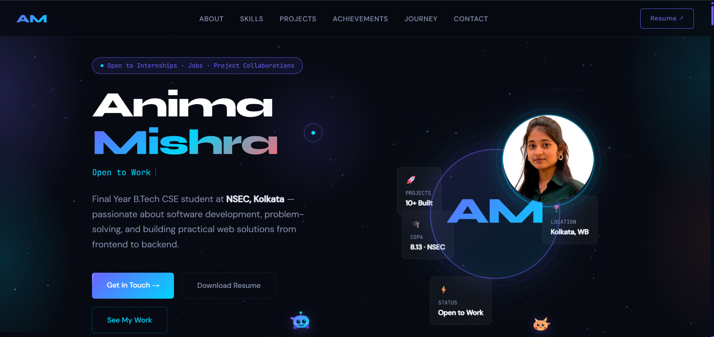

# Anima Mishra — Portfolio

My personal portfolio: projects, skills, achievements and how to reach me.

**Live:** https://animamishra.vercel.app



## What's inside

- About me, skills and the tech I'm learning
- Projects: QuakeShield, Momentum AI, FlashBooking, Sonar Rock vs Mine, Breast Cancer Prediction and AeroTwin
- Achievements, certificates and my education
- Resume download and contact

## Built with

Plain HTML, CSS and JavaScript in one file (`index.html`). No framework and no build step. Hosted on Vercel.

## Run it locally

Open `index.html` in a browser, or serve the folder:

```bash
npx serve .
```

## Contact

- Email: animamishra151@gmail.com
- LinkedIn: https://linkedin.com/in/anima-mishra-bb519026b
- GitHub: https://github.com/codelikepreety
